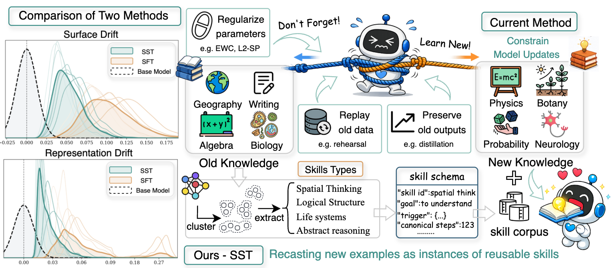

# Skill Forgetting

Implementation of **Combating Catastrophic Forgetting in Continual Domain Adaptation via Knowledge Recasting**.

**Accepted at NeurIPS 2026.**

Skill-augmented continual learning for math reasoning and agent tasks.
The implementation extracts reusable skills from training solutions, stores and
updates them in a shared memory, retrieves relevant skills by embedding similarity,
and adds them to prompts for sequential SFT or GRPO.



**Figure 1. Overview of Skill Schema Transport (SST).** SST recasts new-domain
examples as instances of reusable skill schemas. The pipeline extracts, abstracts,
and stores procedural skills for schema-conditioned updates.

## Layout

```text
src/skill_forgetting/
  memory/    Skill schema, persistence, extraction, updates, retrieval, prompts
  math/      Math data preparation, seed skills, augmentation, reward, evaluation
  agents/    Agent data preparation, seed skills, augmentation, reward, evaluation
  training/  Sequential LlamaFactory SFT and VERL GRPO launchers
tests/       CPU checks for the core pipeline and training orchestration
```

## Setup

Use Python 3.10+ and install the package from this directory:

```bash
python -m pip install -e .
```

Extraction and evaluation additionally need vLLM and Transformers. SFT uses an
external LlamaFactory installation; GRPO uses an external VERL installation with
FSDP and vLLM. Optional dependency groups are `inference`, `sft`, and `rl`, for
example `python -m pip install -e '.[inference]'`. Install training frameworks in
environments appropriate for your CUDA version.

The GRPO dependency group uses VERL 0.8.0.

Retrieval defaults to `BAAI/bge-small-en-v1.5`. Set `SKILL_EMBEDDING_MODEL` to a
model ID or local directory to change it. Model access and downloads use your
normal Hugging Face configuration.

## Data

| Data | Hugging Face | Preparation |
| --- | --- | --- |
| MATH (native train/test splits; default) | [EleutherAI/hendrycks_math](https://huggingface.co/datasets/EleutherAI/hendrycks_math) | `python -m skill_forgetting.math.download --source hendrycks_math` |
| Competition MATH (alternative) | [qwedsacf/competition_math](https://huggingface.co/datasets/qwedsacf/competition_math) | `python -m skill_forgetting.math.download --source competition_math` |
| ALFWorld / WebShop / Search | [Jianwen/SkillRL-SFT-Data](https://huggingface.co/datasets/Jianwen/SkillRL-SFT-Data) | `python -m skill_forgetting.agents.prepare --run_root runs/agents` |

The commands download and prepare data locally. For the alternative math dataset,
pass `--by_type_dir data/competition_math_splits/train/by_type` to
`skill_forgetting.math.prepare`; it creates a seeded train/test split.
Dataset licenses and usage details are available on the linked HF pages.

## Math SFT

Run from the repository root. Commands write prepared data and training
artifacts under `data/` and `runs/`.

```bash
python -m skill_forgetting.math.download --source hendrycks_math
python -m skill_forgetting.math.prepare --run_root runs/math \
  --by_type_dir data/hendrycks_math_splits
python -m skill_forgetting.math.build_memory --run_root runs/math \
  --extractor_model Qwen/Qwen2.5-3B-Instruct
python -m skill_forgetting.math.augment --run_root runs/math --top_k_skills 2
python -m skill_forgetting.training.sft --run_root runs/math \
  --model Qwen/Qwen2.5-3B-Instruct --template qwen
```

The training order is algebra → counting/probability → geometry → intermediate
algebra. Evaluation also includes number theory, prealgebra, and precalculus.
Native train/test splits are preserved; memory extraction reads training data
only. Skill memory is built across all four training domains before sequential
model training.

Use `--finetuning_type lora --learning_rate 1e-4` for LoRA. Adapters are merged
after each stage before training the next one. Choose the matching LlamaFactory
`--template` when changing model families.

```bash
python -m skill_forgetting.math.evaluate \
  --model runs/math/checkpoints/step_04_intermediate_algebra \
  --input_jsonl runs/math/per_type_data_with_raw/algebra/test_raw.jsonl \
  --output_jsonl runs/math/eval/algebra.jsonl \
  --skill_memory_dir runs/math/memory --top_k_skills 2
```

Omit `--skill_memory_dir` to evaluate the trained model without test-time
retrieval. Predictions contain the gold solution for scoring with
`skill_forgetting.memory.utils.compare_answers`.

## Agent GRPO

```bash
python -m skill_forgetting.agents.prepare --run_root runs/agents
python -m skill_forgetting.agents.build_memory --run_root runs/agents \
  --extractor_model Qwen/Qwen2.5-3B-Instruct
python -m skill_forgetting.agents.augment --run_root runs/agents --top_k_skills 4
python -m skill_forgetting.agents.build_grpo_data --run_root runs/agents
python -m skill_forgetting.training.grpo --domain agents --run_root runs/agents \
  --model Qwen/Qwen2.5-3B-Instruct
```

The sequence is ALFWorld → WebShop → Search. GRPO uses fixed trajectory prompts
and local action/format rewards; it does not interact with live environments.
As with math, skill memory is built from all training environments before
sequential model training.
For faster extraction, `agents.build_memory_batched` accepts `--run_root`,
`--raw_run_root`, and `--batch_size`.

```bash
python -m skill_forgetting.agents.evaluate \
  --model runs/agents/checkpoints/step_03_search/merged \
  --input_jsonl runs/agents/agent_sft_skill_augmented/alfworld/skillrl_eval.jsonl \
  --output_jsonl runs/agents/eval/alfworld.jsonl
```

## Math GRPO

Complete math preparation, memory extraction, and augmentation above, then:

```bash
python -m skill_forgetting.math.build_grpo_data --run_root runs/math
python -m skill_forgetting.training.grpo --domain math --run_root runs/math \
  --model Qwen/Qwen2.5-3B-Instruct
```

GRPO chains each stage's merged FSDP checkpoint into the next. Both training
entry points support `--dry_run` to inspect commands without loading models.
GRPO accepts repeated `--override KEY=VALUE` arguments for VERL settings.
Use a fresh run directory for each training run; launchers refuse to overwrite
existing checkpoints.

## Tests

```bash
python -m unittest discover -s tests -v
```

Tests cover the core pipeline and training orchestration on CPU using synthetic
examples and deterministic embeddings.
